# PUB CampusMate — Entity Relationship (ER) Diagram

This document illustrates the relational schema and architectural entity relationships of **PUB CampusMate** (Pundra University of Science & Technology).

## 1. Architectural Overview & Domain Clusters

The database is divided into 8 interconnected domain clusters:
1. **Identity & University Hierarchy**: `users`, `departments`, `teachers`, `students`, `academic_advisors`, `semesters`
2. **Curriculum & Master Catalog**: `curricula`, `courses`, `curriculum_courses`, `course_prerequisites`
3. **Offerings & Allocation**: `rooms`, `course_offerings`, `sections`, `teacher_assignments`, `teacher_availability`
4. **Academic History & Registration**: `student_course_history`, `registration_requests`, `registration_request_items`, `registrations`
5. **Timetable & Scheduling**: `class_schedules`, `schedule_revisions`, `makeup_classes`, `exams`
6. **Communication & Alerts**: `notices`, `notice_recipients`, `notifications`
7. **Faculty Directory**: `faculty_profiles`
8. **AI Helpdesk & Audit**: `academic_documents`, `document_chunks`, `helpdesk_conversations`, `helpdesk_messages`, `audit_logs`

---

## 2. Mermaid Entity Relationship Diagram

```mermaid
erDiagram
    DEPARTMENTS ||--o{ USERS : "has"
    DEPARTMENTS ||--o{ TEACHERS : "employs"
    DEPARTMENTS ||--o{ STUDENTS : "enrolls"
    DEPARTMENTS ||--o{ CURRICULA : "defines"
    DEPARTMENTS ||--o{ COURSES : "offers"
    DEPARTMENTS ||--o{ COURSE_OFFERINGS : "sponsors"

    USERS ||--o| TEACHERS : "profile_for"
    USERS ||--o| STUDENTS : "profile_for"
    USERS ||--o{ NOTICES : "publishes"
    USERS ||--o{ NOTIFICATIONS : "receives"
    USERS ||--o{ AUDIT_LOGS : "performs"
    USERS ||--o{ HELPDESK_CONVERSATIONS : "initiates"

    SEMESTERS ||--o{ COURSE_OFFERINGS : "contains"
    SEMESTERS ||--o{ REGISTRATION_REQUESTS : "collects"
    SEMESTERS ||--o{ REGISTRATIONS : "records"
    SEMESTERS ||--o{ CLASS_SCHEDULES : "schedules"

    TEACHERS ||--o| FACULTY_PROFILES : "details"
    TEACHERS ||--o{ ACADEMIC_ADVISORS : "advises_students"
    TEACHERS ||--o{ TEACHER_ASSIGNMENTS : "assigned_to"
    TEACHERS ||--o{ TEACHER_AVAILABILITY : "declares"
    TEACHERS ||--o{ CLASS_SCHEDULES : "conducts"
    TEACHERS ||--o{ MAKEUP_CLASSES : "conducts"

    STUDENTS ||--o| ACADEMIC_ADVISORS : "assigned_advisor"
    STUDENTS ||--o{ STUDENT_COURSE_HISTORY : "transcript"
    STUDENTS ||--o{ REGISTRATION_REQUESTS : "submits"
    STUDENTS ||--o{ REGISTRATIONS : "enrolls"

    CURRICULA ||--o{ CURRICULUM_COURSES : "contains"
    COURSES ||--o{ CURRICULUM_COURSES : "included_in"
    COURSES ||--o{ COURSE_PREREQUISITES : "requires"
    COURSES ||--o{ COURSE_OFFERINGS : "scheduled_as"
    COURSES ||--o{ STUDENT_COURSE_HISTORY : "graded_for"

    COURSE_OFFERINGS ||--o{ SECTIONS : "divided_into"
    COURSE_OFFERINGS ||--o{ EXAMS : "tested_in"

    SECTIONS ||--o{ TEACHER_ASSIGNMENTS : "taught_by"
    SECTIONS ||--o{ CLASS_SCHEDULES : "timed_in"
    SECTIONS ||--o{ REGISTRATION_REQUEST_ITEMS : "requested_in"
    SECTIONS ||--o{ REGISTRATIONS : "confirmed_in"
    SECTIONS ||--o{ MAKEUP_CLASSES : "rescheduled_for"

    ROOMS ||--o{ CLASS_SCHEDULES : "hosts"
    ROOMS ||--o{ MAKEUP_CLASSES : "hosts"
    ROOMS ||--o{ EXAMS : "hosts"

    REGISTRATION_REQUESTS ||--o{ REGISTRATION_REQUEST_ITEMS : "includes"
    REGISTRATION_REQUESTS ||--o{ REGISTRATIONS : "generates"

    CLASS_SCHEDULES ||--o{ SCHEDULE_REVISIONS : "revised_history"

    NOTICES ||--o{ NOTICE_RECIPIENTS : "targeted_to"

    ACADEMIC_DOCUMENTS ||--o{ DOCUMENT_CHUNKS : "chunked_into"

    HELPDESK_CONVERSATIONS ||--o{ HELPDESK_MESSAGES : "contains"

    USERS {
        int id PK
        string username UK
        string email UK
        string role
        string first_name
        string last_name
        boolean is_active
    }

    DEPARTMENTS {
        int id PK
        string code UK
        string name
        string faculty_name
    }

    STUDENTS {
        int id PK
        int user_id FK
        int department_id FK
        string student_id_card UK
        string batch_no
        decimal cgpa
        decimal completed_credits
    }

    TEACHERS {
        int id PK
        int user_id FK
        int department_id FK
        string teacher_id_card UK
        string designation
        string office_room
    }

    COURSES {
        int id PK
        int department_id FK
        string course_code UK
        string title
        decimal credit
        enum course_type
    }

    COURSE_PREREQUISITES {
        int id PK
        int course_id FK
        int prerequisite_course_id FK
        string min_grade
        boolean is_mandatory
    }

    SEMESTERS {
        int id PK
        string code UK
        string name
        enum term
        date start_date
        date end_date
        datetime registration_end
    }

    COURSE_OFFERINGS {
        int id PK
        int semester_id FK
        int course_id FK
        int department_id FK
    }

    SECTIONS {
        int id PK
        int course_offering_id FK
        string section_name
        int capacity
        int enrolled_count
    }

    REGISTRATIONS {
        int id PK
        int student_id FK
        int section_id FK
        int semester_id FK
        enum status
        datetime enrolled_at
    }

    CLASS_SCHEDULES {
        int id PK
        int section_id FK
        int room_id FK
        int teacher_id FK
        int semester_id FK
        enum day_of_week
        time start_time
        time end_time
    }

    ACADEMIC_DOCUMENTS {
        int id PK
        string document_code UK
        string title
        enum category
        string file_path
    }

    DOCUMENT_CHUNKS {
        int id PK
        int document_id FK
        int chunk_index
        text content
        json metadata_json
    }

    HELPDESK_MESSAGES {
        int id PK
        int conversation_id FK
        enum sender_type
        text message
        json sources_cited_json
    }

    AUDIT_LOGS {
        bigint id PK
        int user_id FK
        string action
        string entity_type
        int entity_id
        datetime created_at
    }
```

---

## 3. Key Relational Constraints & Business Rules

1. **Prerequisite Integrity**: Stored in `course_prerequisites` as directed edges `(course_id -> prerequisite_course_id)` preventing single-field text parsing and enabling recursive DFS/BFS dependency graph traversals.
2. **Duplicate Prevention**:
   - `registrations` enforces `UNIQUE(student_id, section_id)`.
   - `registration_requests` links individual `registration_request_items` with `UNIQUE(request_id, section_id)`.
3. **Seat Capacity Protection**:
   - `sections` tracks both `capacity` and `enrolled_count`. During registration approval, row-level locks (`SELECT ... FOR UPDATE`) ensure capacity is never exceeded.
4. **Collision Detection Indexes**:
   - `class_schedules` has compound indexes on `(room_id, day_of_week, start_time, end_time)`, `(teacher_id, day_of_week, start_time, end_time)`, and `(section_id, day_of_week, start_time, end_time)` to instantly detect conflicts.
5. **AI Helpdesk (RAG)**:
   - `document_chunks` includes both `FULLTEXT(content, chunk_title)` for MySQL native BM25 full-text retrieval and an `embedding_id` reference to allow optional hybrid dense vector search.
